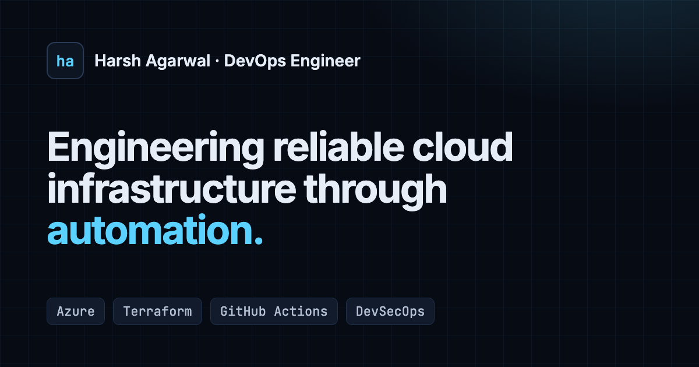

# Harsh Agarwal: DevOps Engineer Portfolio

A single-page portfolio for a DevOps / Cloud / Platform engineer working mainly with **Azure** and **Terraform**.
It's a framework-free static site with a strict Content Security Policy and no client-side secrets, checked in CI on every push.

- **Live (Netlify):** https://harshagarwal-portfolio.netlify.app/
- **Mirror (GitHub Pages):** https://harshagarwal1102.github.io/Portfolio_Website/



> The image above is the Open Graph card. Replace it with a full-page screenshot if you prefer.

## What's on the page

| Section | What it does |
| --- | --- |
| Hero | Headline, rotating focus line, résumé and profile links, and a replayable terminal transcript (labelled illustrative) |
| About | Verified profile summary and working principles |
| Skills | Grouped toolchain with no proficiency bars, limited to tools used in public repos or listed on the GitHub profile |
| Experience | Timeline that separates professional roles, independent projects, education and internships |
| Projects | Filterable cards with real repository links and case-study dialogs. Metrics come from each project's own CI records |
| Architecture | Interactive PR → plan → approval → apply → Azure diagram plus a drift-detection flow. Each node says where it runs today or that it's **planned** |
| Pipeline explorer | Illustrative stage-by-stage Terraform pipeline with example output, clearly marked as not live CI data |
| Learning | Verifiable certificate, recent writing, current work |
| Contact | Validated form with real delivery (see below), plus direct links |

## Tech stack

- Semantic HTML5, one stylesheet (`assets/css/styles.css`) built on CSS custom properties, and small native ES modules
- Self-hosted Inter and JetBrains Mono variable fonts (OFL-1.1). No CDNs, analytics or trackers
- Node's built-in test runner plus a zero-dependency checker script. **There are no npm dependencies and no build step**
- GitHub Actions for CI, with actions pinned by commit SHA and read-only permissions

```
index.html                 the whole site (content, icon sprite, case-study templates)
404.html                   self-contained not-found page
favicon.svg                monogram favicon
assets/css/styles.css      design tokens, components, sections, responsive rules, motion
assets/js/main.js          nav, active section, reveal, hero animations, filters, dialog
assets/js/architecture.js  interactive architecture diagram (node data lives here)
assets/js/pipeline.js      pipeline explorer (stage data lives here)
assets/js/contact.js       contact form UI and delivery
assets/js/validate.js      pure validation/provider helpers (unit-tested)
assets/js/config.js        public site configuration: résumé URL, form provider
assets/fonts, assets/img, assets/docs
scripts/check-site.mjs     link/asset/anchor/CSP/a11y/secret-pattern checker
tests/                     node --test suites
netlify.toml               publish settings and security headers
.github/workflows/site-checks.yml
```

## Run locally

ES modules don't load from `file://`, so serve the folder over HTTP:

```bash
python3 -m http.server 8080
```

Then open http://localhost:8080. `npm start` runs the same command.

## Checks and tests

Requires Node 20 or newer. There's nothing to install.

```bash
npm run check
```

```bash
npm test
```

`npm run check` verifies local links, in-page anchors, icon references, CSS and JS asset paths, safe `target="_blank"` links, image alt text and dimensions, button names, no inline styles or scripts (required by the CSP), and secret-like strings. It prints file and line only, never the matched value. `npm test` runs those checks plus unit tests for form validation and provider selection. CI runs both on every push and pull request.

## Contact form delivery

The form validates on the client, shows loading, success and error states, keeps the visitor's text on failure, and includes a honeypot field. How it delivers is set in `assets/js/config.js` under `contact.provider`:

| Provider | When it's used | Setup |
| --- | --- | --- |
| `netlify` | `auto` on any `*.netlify.app` host or a host listed in `netlifyHosts` | Netlify dashboard → **Forms** → enable form detection, then redeploy. Add an email notification under **Forms → Form notifications** so submissions reach your inbox |
| `formspree` | `auto` whenever `formspreeEndpoint` is set (works on GitHub Pages too) | Create a form at formspree.io, then set `formspreeEndpoint: 'https://formspree.io/f/<id>'`. The ID is a public identifier, not a secret |
| `mailto` | `auto` fallback when neither of the above applies | None. The page says so openly and opens the visitor's email app with the message filled in |

No credentials live in the frontend. The CSP allows network requests only to the site itself and `https://formspree.io`.

**Status of delivery:** the Netlify and Formspree integrations are implemented, and their success and failure UI was exercised locally with a stubbed request. Real delivery **hasn't been tested end to end**, because that needs Netlify form detection turned on (or a Formspree form ID) in your accounts. Until one of those is configured, the GitHub Pages copy uses the `mailto` fallback.

## Résumé

Every "Résumé" link uses `config.resumeUrl` in `assets/js/config.js`. The HTML also carries the same URL so the links work without JavaScript. It currently points to the public Google Drive PDF linked from the GitHub profile. To self-host it instead, put the PDF at `assets/docs/Harsh_Agarwal_Resume.pdf` and set `resumeUrl` (and the two `data-resume-link` hrefs in `index.html`) to that path.

## Deployment

The site is plain static files. Deploy the repository root with no build command.

- **Netlify:** connect the repo, leave the build command empty and set the publish directory to `.` (already in `netlify.toml`). The security headers in `netlify.toml` apply automatically.
- **GitHub Pages:** Settings → Pages → deploy from branch `main`, folder `/`. `.nojekyll` skips Jekyll processing. GitHub Pages can't set response headers, so only the CSP `<meta>` tag applies there.
- `404.html` is served automatically by both hosts. It's self-contained so it renders from any nested path.

The canonical URL, Open Graph URLs, `robots.txt` and `sitemap.xml` point to the Netlify domain. Update them if that changes.

## Security notes

- The previous version embedded an email-service token, plus a commented-out SMTP password, in `script.js`. Both are removed from the current code, but **they remain in Git history**. Treat them as compromised and revoke or rotate them with the provider (the SMTP.js secure token and the Elastic Email SMTP credentials). History was not rewritten, because that requires a force-push.
- External links open with `rel="noopener noreferrer"`. There are no inline scripts or styles on the main page, and no third-party scripts.

## Known limitations

- Real form delivery needs the provider configuration described above. It can't be verified without your account settings.
- Lighthouse scores were measured locally against `python3 -m http.server`, which doesn't compress or cache, so production results may differ slightly.
- The pipeline explorer and hero terminal are illustrative and deliberately not connected to live CI.
- The Hansa Solutions role description is intentionally brief. Add concrete responsibilities you're comfortable sharing in `index.html` under `#experience`.
